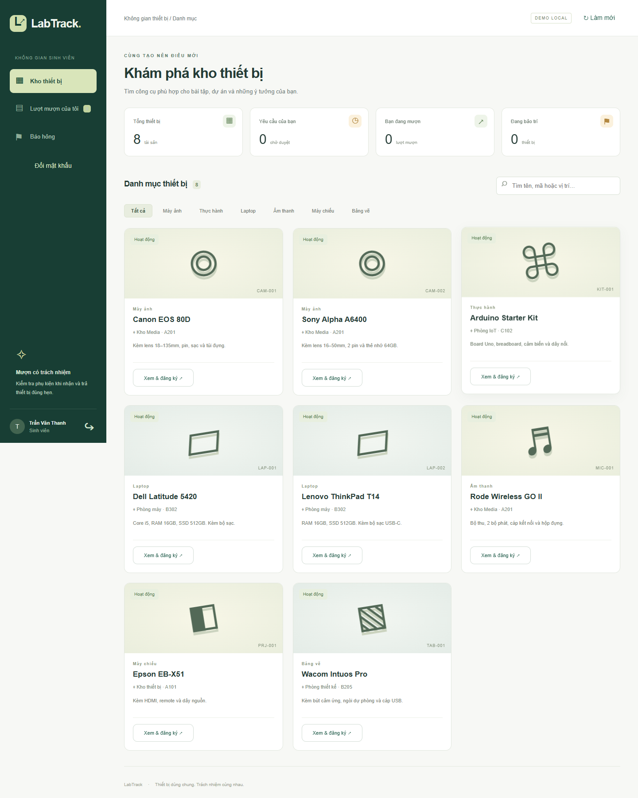
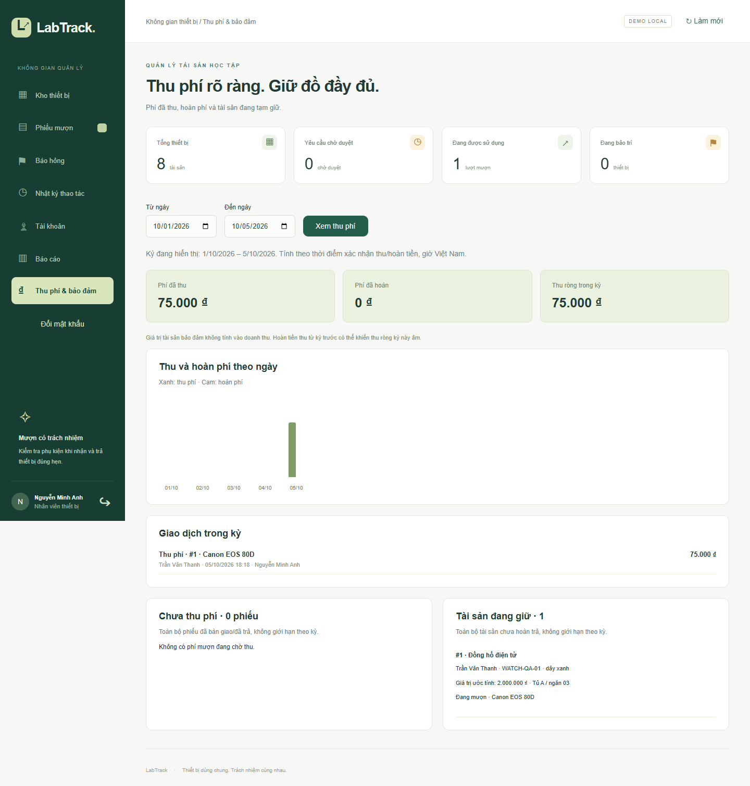

# LabTrack — Quản lý mượn thiết bị và báo hỏng

Ứng dụng đồ án cho trường học: quản lý từng tài sản, xem lịch được duyệt, mượn–trả, báo hỏng và ghi lịch sử thao tác. Đây là dự án riêng, không dùng chung database hoặc source với Tea House.

**Java 21 · Spring Boot · Angular · TypeScript · JPA/Hibernate · Flyway**

Có phí mượn theo ngày, ghi nhận thu/hoàn phí và tài sản bảo đảm. Bản local chạy bằng H2; có cấu hình PostgreSQL nhưng chưa xác minh trên PostgreSQL thực tế. Bộ kiểm thử hiện có 19 test đạt; xem [kết quả kiểm thử](docs/TEST-RESULTS.md) và [kiến trúc/API](docs/ARCHITECTURE.md).

## Giao diện minh họa

Ảnh dùng dữ liệu demo/kiểm thử, không phải giao dịch thực tế.





## Chạy bản local

Trên máy đã build: nhấp đúp **CHAY-LABTRACK.cmd**, chờ dòng `Started LabTrackApplication`, mở **http://127.0.0.1:8081**. Giữ cửa sổ server mở. Nhấn Ctrl+C để dừng; chỉ mở một server dùng database H2 này.

| Vai trò demo | Email | Mật khẩu |
|---|---|---|
| Nhân viên thiết bị | staff@labtrack.local | LabTrack@123 |
| Sinh viên | student@labtrack.local | Student@123 |

Chế độ mặc định là **demo H2**, dữ liệu lưu trong `data/` và giữ qua lần khởi động sau. Không dùng database MySQL của Tea House. Tài khoản mẫu chỉ được tạo khi database mới chưa có tài khoản.

## Chức năng bổ sung: quản lý và báo cáo

- **Tài khoản:** nhân viên tạo tài khoản sinh viên, khóa/mở khóa. Không cho tạo thêm quyền nhân viên từ API này và không cho khóa tài khoản nhân viên. Khóa tài khoản thu hồi phiên cũ; mở lại vẫn cần đăng nhập mới. Phiếu đã có vẫn được giữ để nhân viên xử lý.
- **Đổi mật khẩu:** có ở thanh bên cho cả hai vai trò, yêu cầu mật khẩu hiện tại; sau khi đổi phải đăng nhập lại trên mọi thiết bị. Mật khẩu từ 10 ký tự và tối đa 72 byte UTF-8. Không ghi mật khẩu vào nhật ký. Các nút điền tài khoản demo vẫn điền mật khẩu mẫu; nếu đã đổi, nhập mật khẩu mới của bạn.
- **Sửa thiết bị:** thay tên, danh mục, vị trí và mô tả; mã tài sản giữ nguyên. Phiếu mượn lưu bản chụp tên/mã lúc tạo, không đổi theo tên mới.
- **Ngừng sử dụng / sử dụng lại:** giữ lịch sử và chặn mượn mới. Phải xử lý hết phiếu PENDING, APPROVED, CHECKED_OUT trước khi ngừng dùng. Thiết bị ngừng dùng được ẩn khỏi danh mục mặc định; nhân viên có nút hiện lại. Mở lại không tự xóa trạng thái bảo trì.
- **Báo cáo:** chọn tối đa 366 ngày; đếm yêu cầu theo ngày tạo UTC+7, biểu đồ ngày, trạng thái hiện tại của phiếu trong kỳ và top 5 thiết bị theo số yêu cầu (bao gồm phiếu hủy/từ chối). Danh sách quá hạn gồm toàn bộ phiếu đang mượn quá hạn tính đến hôm nay, không giới hạn trong kỳ báo cáo.

Migration V2 bổ sung trường tài khoản, ngừng dùng và tên/mã trên phiếu; các phiếu V1 được điền tên/mã từ thiết bị tại thời điểm nâng cấp. Bản sao lưu trước nâng cấp nằm ở `data/backups/`, không đưa vào source ZIP/Git. Không tự chạy lại bản JAR V1 lên database V2; nếu cần quay lại, phục hồi cả database backup lẫn bản mã nguồn tương ứng.

## Phí mượn, doanh thu và tài sản bảo đảm

### Cách sử dụng

1. Nhân viên → **Kho thiết bị → Phí/ngày** để đặt đơn giá nguyên VNĐ (0 đến 10.000.000đ/ngày; 0 là miễn phí). Thiết bị cũ/new mặc định 0, không tự áp đặt mức thu. Đơn giá thay đổi chỉ áp dụng phiếu mới.
2. Sinh viên mở thiết bị, chọn ngày nhận/trả, xem phí dự kiến rồi gửi yêu cầu. **Phí = đơn giá × số ngày, gồm cả ngày nhận và trả** (mượn/trả cùng ngày tính 1 ngày). Backend tính lại và lưu đơn giá, số ngày, tổng phí vào phiếu; thay giá khi người dùng đang mở form sẽ yêu cầu xem lại mức phí.
3. Sau khi duyệt, nhân viên chọn **Nhận tài sản bảo đảm**, nhập tên món đồ, mã/đặc điểm nhận diện, giá trị ước tính, tình trạng/phụ kiện và vị trí cất giữ. Nhân viên xác nhận đã nhận thực tế. **Mọi thiết bị, kể cả miễn phí, đều bắt buộc tài sản bảo đảm trước khi bàn giao**.
4. Chọn **Bàn giao thiết bị**. Từ lúc này có thể **Thu phí**, hoặc thu sau khi nhận trả. Chọn tiền mặt/chuyển khoản đã kiểm tra, xác nhận đã nhận đủ tiền; chuyển khoản yêu cầu mã tham chiếu. Đây là ghi sổ thủ công, không tích hợp ngân hàng.
5. Khi sinh viên trả: **Nhận trả** thiết bị, rồi **Trả tài sản bảo đảm**, ghi tình trạng/người nhận và xác nhận đã trao đúng món đồ. Hai thao tác tách riêng để không đánh dấu đã trả tài sản khi thực tế chưa trả.
6. Vào **Thu phí & bảo đảm** để xem phí đã thu, đã hoàn, thu ròng, biểu đồ, từng giao dịch, phiếu chưa thu và tài sản đang giữ.

### Quy tắc ghi sổ

- Giá và số ngày đã chốt theo lịch đăng ký; trả sớm không tự giảm phí, trả muộn không tự cộng phí. Bản này chưa thu phí quá hạn hoặc bồi thường.
- Không thu phí trước khi thiết bị được bàn giao; phiếu hủy/từ chối không tạo doanh thu. Miễn phí không cần thao tác thu. Chỉ nhân viên được ghi thu/hoàn, đúng một lần thu đủ tổng phí trên mỗi phiếu; khóa transaction chống bấm lặp/đồng thời.
- **Hoàn phí**: hoàn toàn bộ một lần, phải nhập lý do và xác nhận đã trả tiền thực tế. Không hỗ trợ hoàn một phần hoặc thu lại sau hoàn trong phiên bản này. Không tự thay đổi việc giữ tài sản/bàn giao thiết bị.
- Báo cáo tính thu theo `paidAt`, hoàn theo `refundedAt`, giờ Việt Nam. **Thu ròng = tiền thu trong kỳ − tiền hoàn trong kỳ**. Có thể âm nếu hoàn khoản thu từ kỳ trước. Đây không phải lợi nhuận.
- Tên món đồ và giá trị ước tính chỉ phục vụ theo dõi tạm giữ; **không cộng vào doanh thu**, không tự trừ nợ hoặc chuyển quyền sở hữu. Giá trị do nhân viên nhập và kiểm tra; ứng dụng không tự định giá hoặc áp mức tối thiểu theo giá thiết bị.
- Phiếu có tài sản đang giữ không được sinh viên hủy trực tiếp. Nếu chưa bàn giao, nhân viên chọn **Hủy bàn giao & trả tài sản**: vừa ghi nhận hoàn đồ vừa chuyển phiếu sang CANCELLED. Khi đã bàn giao, phải nhận trả thiết bị trước rồi mới hoàn đồ.
- Tài sản đang giữ và phí chưa thu là danh sách toàn bộ hiện tại, không giới hạn theo kỳ báo cáo. Phiếu chưa thu chỉ gồm CHECKED_OUT/RETURNED có phí > 0 và chưa ghi thu; phiếu đã hoàn không xuất hiện như khoản phải thu mới.
- Mọi giao dịch lưu nhân viên và thời điểm. Sinh viên xem thông tin phí/tài sản trên phiếu của mình; không được sửa thông tin thu/hoàn hoặc xem doanh thu chung.

### Nâng cấp dữ liệu cũ

Migration V3 không tự tạo doanh thu: đơn giá/tổng phí trên phiếu cũ bằng 0, không có thông tin đã thu hoặc đã giữ đồ giả. Phiếu cũ còn PENDING/APPROVED phải nhận tài sản trước khi bàn giao. Phiếu đã bàn giao từ trước giữ nguyên lịch sử, không tự tạo nghĩa vụ giao nhận tài sản hồi tố. Sao lưu trước nâng cấp nằm trong `data/backups` và bị loại khỏi ZIP/Git.

## Công nghệ

- Java 21, Spring Boot 3.5.16, Spring Data JPA/Hibernate; Flyway migration.
- Angular 21.2.25, TypeScript 5.9.3, Angular Material 21.2.14.
- PostgreSQL: có JDBC driver và profile cấu hình; **chưa xác minh trên PostgreSQL thực tế vì máy chưa cài server**.
- H2 2.3 (chế độ tương thích PostgreSQL) cho demo local và kiểm thử mặc định.
- JUnit 5 và Spring Boot Test; Maven quản lý thư viện Java, npm lockfile khóa frontend.

Java 21.0.11, Maven 3.9.16 và Node 24.18.0 đã có trên máy. Tham chiếu tương thích: [Angular](https://angular.dev/reference/versions), [Spring Boot 3.5](https://docs.spring.io/spring-boot/3.5/system-requirements.html).

## Build từ source

Cần JDK 21, Maven 3.6.3+ và Node 24. Có mạng trong lần tải thư viện đầu. Mở **BUILD-LABTRACK.cmd** hoặc chạy:

```powershell
cd frontend
npm.cmd ci --cache .npm-cache
npm.cmd run build
cd ..
node scripts/copy-frontend.mjs
mvn.cmd package
java -jar target/labtrack-0.1.0.jar
```

JAR chứa cả Angular và API, nên chạy demo chỉ cần Java. `src/main/resources/static` là kết quả build được tạo lại, không sửa trực tiếp và không commit. Muốn sửa UI: chạy backend bằng `mvn.cmd spring-boot:run`, frontend bằng `npm.cmd start` trong `frontend`, truy cập http://localhost:4200. Proxy chuyển `/api` về 8081.

Kiểm thử nghiệp vụ: `mvn.cmd test`. Dùng database trong bộ nhớ riêng, không sửa dữ liệu demo.

## Chuyển sang PostgreSQL

Cần cài PostgreSQL trước, tạo database `labtrack` thuộc user riêng có quyền tạo bảng trong schema của database. Trên PowerShell, đặt biến môi trường rồi chạy JAR:

```powershell
$env:SPRING_PROFILES_ACTIVE='postgres'
$env:DB_URL='jdbc:postgresql://127.0.0.1:5432/labtrack'
$env:DB_USER='labtrack'
# Nhập bí mật trên máy; không đưa mật khẩu vào source hoặc commit.
$env:DB_PASSWORD=Read-Host 'Mat khau PostgreSQL' -MaskInput
$env:LABTRACK_STAFF_PASSWORD=Read-Host 'Mat khau nhan vien moi (>=10 ky tu)' -MaskInput
$env:LABTRACK_STUDENT_PASSWORD=Read-Host 'Mat khau sinh vien moi (>=10 ky tu)' -MaskInput
java -jar target/labtrack-0.1.0.jar
```

`-MaskInput` cần PowerShell 7. Các mật khẩu seed chỉ áp dụng database mới và phải có ít nhất 10 ký tự. Email seed giữ nguyên như bảng trên; PostgreSQL không tự dùng mật khẩu demo. Biến môi trường sống trong cửa sổ PowerShell hiện tại; đóng cửa sổ để kết thúc. Không tự chuyển dữ liệu H2 sang PostgreSQL. Không sửa migration V1 sau khi đã áp dụng; thêm V2 cho thay đổi tiếp theo.

## Luồng demo

1. Đăng nhập sinh viên → Kho thiết bị → Xem & đăng ký → chọn ngày hôm nay, ngày trả và mục đích → gửi yêu cầu.
2. Đăng xuất, đăng nhập nhân viên → Phiếu mượn → Duyệt → Nhận tài sản bảo đảm → Bàn giao.
3. Đăng nhập sinh viên → Lượt mượn → Báo hỏng. Thiết bị chuyển sang bảo trì.
4. Nhân viên nhận trả, ghi tình trạng và hoàn trả tài sản bảo đảm; vào Báo hỏng ghi kết quả sửa chữa.
5. Kiểm tra thiết bị hoạt động lại và Nhật ký ghi đủ các thao tác.

## Quy tắc nghiệp vụ

- Mỗi tài sản có mã duy nhất. Hai laptop cùng mẫu là hai tài sản với lịch riêng.
- Thời gian tính theo ngày Việt Nam, gồm cả ngày mượn và ngày trả. Ngày bắt đầu không ở quá khứ, hạn trả không trước ngày bắt đầu và không vượt quá 30 ngày sau ngày bắt đầu.
- Yêu cầu chờ duyệt có thể giao nhau giữa các sinh viên. Khi duyệt, backend khóa hàng thiết bị trong transaction và kiểm tra giao lịch với phiếu APPROVED/CHECKED_OUT.
- Không bàn giao trước ngày bắt đầu hoặc sau ngày trả. Không bàn giao khi thiết bị đang bảo trì hoặc còn lượt chưa trả.
- Sinh viên chỉ xem/hủy phiếu của mình; chỉ báo hỏng thiết bị đang được bàn giao cho mình. Có thể hủy trước khi nhận.
- Nhận trả yêu cầu ghi tình trạng/phụ kiện. Báo hỏng chuyển tài sản sang bảo trì. Chỉ trở lại hoạt động khi mọi phiếu báo hỏng đã xử lý.
- Lịch thiết bị không tiết lộ tên người mượn, email hoặc mục đích. Nhân viên xem nghiệp vụ và nhật ký; sinh viên bị chặn bằng API.
- Mật khẩu băm BCrypt, session cookie HttpOnly/SameSite Strict. Thay session ID khi đăng nhập, vô hiệu hóa khi đăng xuất. API ghi dữ liệu yêu cầu header riêng và kiểm tra Origin; không bật CORS tùy ý.

## Cấu trúc

```text
frontend/src/                 Angular, giao diện và thao tác gọi API
src/main/java/vn/labtrack/     Controller, service, entity, repository, auth, seed
src/main/resources/           Profile demo/PostgreSQL, migration SQL
src/test/                     Kiểm thử API/nghiệp vụ và xử lý đồng thời
scripts/                      Đưa bản build frontend vào Spring Boot
docs/                         Kiến trúc, API và kết quả kiểm tra
```

## Phạm vi bản đầu và phần tiếp theo

Đã có đăng nhập, phân quyền, tài khoản sinh viên, đổi mật khẩu, danh mục/tìm kiếm/thêm/sửa/ngừng dùng thiết bị, lịch đã duyệt, yêu cầu mượn–duyệt–bàn giao–nhận trả, hủy/từ chối, báo hỏng–xử lý, báo cáo, nhật ký và responsive.

Chưa có: tự đăng ký, quản lý/thêm tài khoản nhân viên, QR, ảnh thiết bị thật, nhắc quá hạn tự động, phân trang, xuất báo cáo ra file, upload chứng từ, khôi phục mật khẩu khi quên, SSO và triển khai online. Hai vai trò hiện tại là STAFF/STUDENT; chưa tách quản trị viên riêng. Bộ đếm của sinh viên chỉ phản ánh phiếu của họ. Chưa kiểm thử tải lớn, chưa giới hạn thử đăng nhập; bản hiện tại chỉ bind 127.0.0.1 để demo local. Không mở lên Internet bằng tài khoản mặc định.

## Sao lưu

Dừng server trước khi sao chép `data/labtrack.mv.db`; giữ cùng phiên bản mã nguồn. PostgreSQL dùng công cụ sao lưu của PostgreSQL. Không đưa database, mật khẩu, cache, `node_modules` hay file JAR vào Git; `.gitignore` đã loại các đường dẫn sinh tự động.
