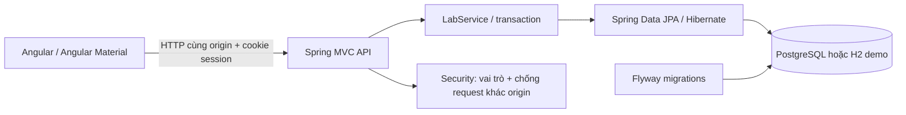
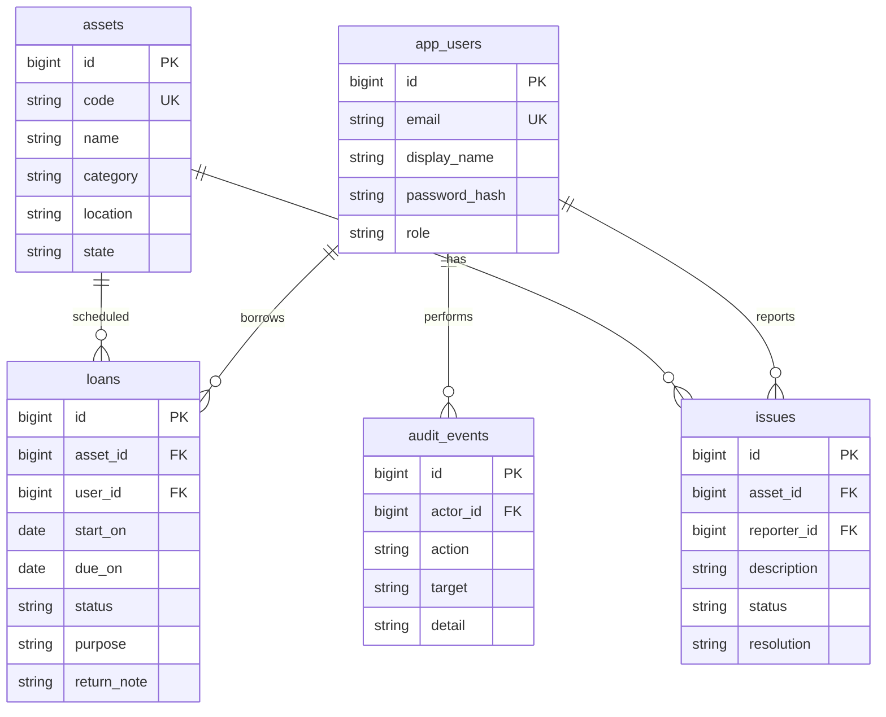
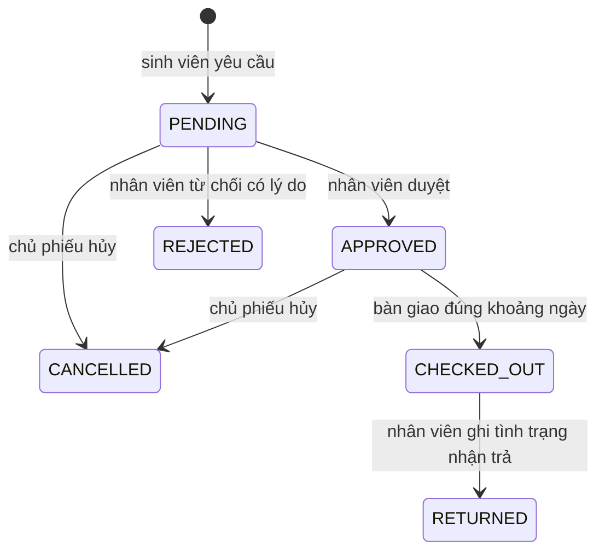

# Kiến trúc và nghiệp vụ LabTrack

## Luồng xử lý

Bản đóng gói Spring Boot phục vụ cả Angular và REST API ở 8081. Khi phát triển, Angular ở 4200 dùng proxy API. Không cần chạy Express hoặc MySQL.

## Dữ liệu

Các event/phiếu ghi thời điểm bằng Instant; frontend hiển thị UTC+7. Khoảng mượn dùng LocalDate theo lịch Việt Nam. Hai khoảng ngày giao nhau khi `existing.start <= request.due` và `existing.due >= request.start`.

## Trạng thái phiếu

Mỗi thao tác thay đổi lịch hoặc tình trạng đều khóa hàng thiết bị bằng PESSIMISTIC_WRITE trong transaction. Hai luồng duyệt cùng tài sản phải lần lượt đọc và kiểm tra lịch sau khi có khóa. Khi chuyển phiếu/báo hỏng, truy vấn đầu chỉ lấy asset_id; sau khi có khóa mới đọc entity phiếu để tránh trạng thái cũ trong persistence context. Khóa ở database giữ đến cuối transaction.

Ghi nhật ký nằm trong cùng transaction với thay đổi nghiệp vụ. Nếu xảy ra xung đột, transaction rollback, không ghi nhật ký thành công giả. Một thiết bị có nhiều báo hỏng chỉ trở lại AVAILABLE khi không còn issue OPEN. RETURNED không tự đánh dấu thiết bị đã sửa xong.

## API

| Method | Đường dẫn `/api` | Quyền / mục đích |
|---|---|---|
| GET | /health | Kiểm tra server, mode |
| POST | /login | Email/password; tạo session |
| GET | /me | Người dùng hiện tại |
| POST | /logout | Hủy session |
| GET | /assets | Người đã đăng nhập |
| POST | /assets | Nhân viên thêm tài sản |
| GET | /assets/{id}/schedule | Khoảng ngày đã duyệt, không lộ người mượn |
| GET | /loans | Nhân viên: tất cả; sinh viên: phiếu của mình |
| POST | /loans | Sinh viên yêu cầu mượn |
| POST | /loans/{id}/action | approve/reject/checkout/return/cancel |
| GET | /issues | Nhân viên: tất cả; sinh viên: báo hỏng của mình |
| POST | /issues | Nhân viên hoặc sinh viên đang giữ thiết bị |
| POST | /issues/{id}/resolve | Nhân viên ghi kết quả sửa |
| GET | /audit | Nhân viên; 100 thao tác gần nhất |

POST dùng JSON, header `X-LabTrack: 1`. Cần gửi cookie nhận từ login. Khi có Origin, chỉ cho origin của server hoặc APP_ORIGIN cấu hình (localhost:4200 mặc định). Không cho frontend ở website khác gọi tự do. Lỗi có `message`; 400 validation, 401 chưa đăng nhập, 403 không đủ quyền, 404 không tồn tại, 409 xung đột nghiệp vụ. Các mẫu body nằm ở record Input trong Api.java.

## Các giới hạn thiết kế cần biết

- Hai vai trò, không hỗ trợ tự nâng quyền/đăng ký. Nhân viên chỉ tạo và khóa/mở tài khoản sinh viên; không quản lý tài khoản nhân viên khác.
- Session lưu trong bộ nhớ server; restart yêu cầu đăng nhập lại. Không dùng localStorage để lưu quyền hoặc dữ liệu nghiệp vụ.
- Ngày trả là ngày cuối cùng thiết bị bị giữ chỗ. Không đặt mượn theo giờ trong bản này.
- Danh sách phiếu chưa phân trang; nhật ký có giới hạn 100. Bộ đếm đang mượn/chờ duyệt là theo dữ liệu mà người dùng được quyền xem.
- Chưa có quy trình nhân viên thu hồi phiếu APPROVED; chủ phiếu có thể hủy. Không có phạt tiền, email hay tác vụ tự động.
- Không coi H2 PostgreSQL mode là kiểm thử PostgreSQL thật. Cần kiểm chứng transaction/lock/migration trên PostgreSQL trước triển khai thực tế.

## API bổ sung trong V2

| Method | Đường dẫn `/api` | Quyền / mục đích |
|---|---|---|
| GET | /users | Nhân viên xem tài khoản |
| POST | /users | Tạo sinh viên: email, name, password; role luôn STUDENT |
| POST | /users/{id}/active | Nhân viên khóa/mở sinh viên: active boolean |
| POST | /me/password | Người đã đăng nhập: currentPassword, newPassword |
| POST | /assets/{id}/edit | Nhân viên sửa theo AssetInput, không đổi mã |
| POST | /assets/{id}/retired | Nhân viên thay retired boolean |
| GET | /reports?from=YYYY-MM-DD&to=YYYY-MM-DD | Nhân viên xem báo cáo UTC+7 |

User có active và auth_version. Login lưu uid/authVersion trong session; mỗi request cần xác thực sẽ kiểm tra trạng thái và phiên bản. Khóa tài khoản hoặc đổi mật khẩu tăng authVersion; phiên cũ không sử dụng lại được ngay cả khi mở khóa. Tài khoản đã khóa không được duyệt/bàn giao mới nhưng nhân viên vẫn nhận trả phiếu cũ.

Asset.retired độc lập với state AVAILABLE/MAINTENANCE; xử lý xong issue không làm thiết bị đã ngừng dùng nhận mượn trở lại. Loan.assetName/assetCode là bản chụp khi tạo; tên thiết bị hiện tại vẫn có trong quan hệ asset để thao tác đúng tài sản.

Báo cáo chọn created_at trong [00:00 from UTC+7, 00:00 ngày sau to UTC+7), tránh đếm trùng ranh giới. Nhóm theo trạng thái hiện tại, không phải thống kê số lần chuyển trạng thái trong kỳ. Quá hạn truy vấn riêng CHECKED_OUT có due_on < hôm nay, nên gồm cả lượt tạo ngoài kỳ.

## V3: phí mượn và tài sản bảo đảm

| Method | Endpoint `/api` | Body / ý nghĩa |
|---|---|---|
| POST | /assets/{id}/rate | dailyRate: nguyên VNĐ, từ 0 đến 10.000.000 |
| POST | /loans | Thêm expectedFee: mức phí người mượn đã xem; server tự tính/chốt |
| POST | /loans/{id}/payment | amount đúng feeTotal, method CASH/BANK_TRANSFER, reference |
| POST | /loans/{id}/refund | reason; hoàn toàn bộ một lần |
| POST | /loans/{id}/collateral | name, identifier, estimatedValue nguyên VNĐ > 0, condition, storage |
| POST | /loans/{id}/collateral-return | note; nếu phiếu APPROVED thì đồng thời hủy phiếu |
| GET | /revenue?from=YYYY-MM-DD&to=YYYY-MM-DD | Nhân viên: thu/hoàn/thu ròng, daily, entries, unpaid, heldCollateral |

Các thay đổi thu/hoàn/nhận-trả đồ và sửa đơn giá cùng khóa hàng asset trước khi đọc phiếu. Khoản thu/hoàn nằm trên loan, không cho sửa thời điểm hoặc số tiền từ client. feeTotal/rentalRate/rentalUnits lưu độc lập với asset hiện tại. paidAt và refundedAt có index; báo cáo lọc khoảng [đầu ngày from, đầu ngày sau to) UTC+7 riêng cho hai thời điểm.

Một phiếu nhận một tài sản và hoàn trả một lần, không xóa bản ghi cũ. Nhận đồ chỉ khi APPROVED; hoàn khi RETURNED, hoặc APPROVED kèm hủy phiếu. Nút giao thiết bị bị chặn khi chưa nhận bảo đảm; API áp dụng cùng quy tắc. Giá trị tài sản nằm ở collateralValue, không tham gia phép tính tiền phí/doanh thu.

Các trường mới ở V3 có mặc định an toàn, không thu phí hồi tố. Khoản phí cũ bằng 0; không suy ra việc đã giao/nhận tài sản từ trạng thái phiếu.
